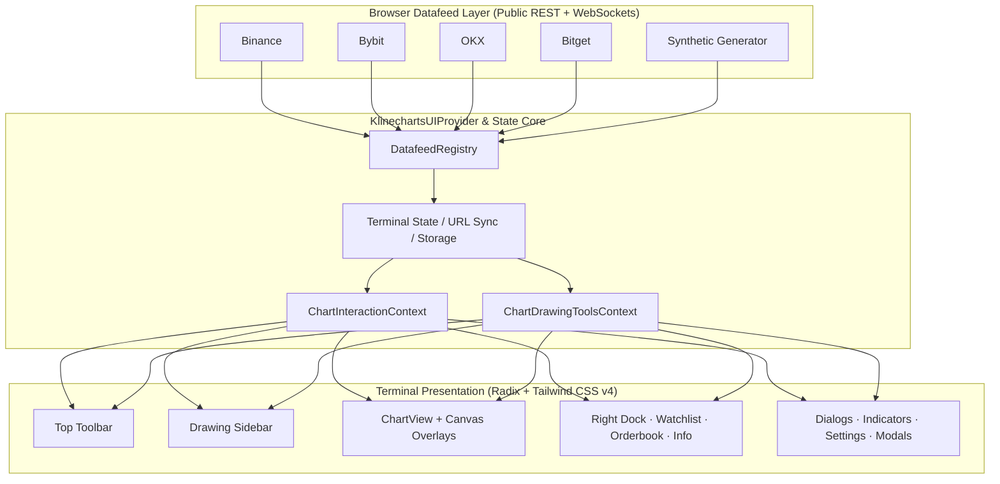

# KlineChart UI Core

> High-performance financial trading terminal and charting core for React.
> Powered by [klinecharts](https://klinecharts.com) v10.1, React 19, Tailwind CSS v4, and Radix UI.
> Fully self-contained: zero backend dependencies, zero third-party UI framework lock-in, with inlined headless state and drawing engines.

[](https://aztharion.github.io/klinechart-ui-core/)
[](https://www.typescriptlang.org/)
[](https://react.dev/)
[](https://tailwindcss.com/)
[](https://klinecharts.com/)
[](https://github.com/sponsors/aztharion)
[](LICENSE)
[](https://github.com/aztharion/klinechart-ui-core/pulls)

```text
  ┌────────────────────────────────────────────────────────────────────────┐
  │  BTCUSDT · Binance   15m   Indicators   Compare   Themes   [Fullscreen]    │
  ├──────┬──────────────────────────────────────────────────────────┬──────┤
  │ [/]  │  Candlestick / Heikin-Ashi Canvas                        │Watch-│
  │ [—]  │                                                          │list  │
  │ [F]  │  Volume Profile (VPVR & FRVP) Engine                     ├──────┤
  │ [M]  │                                                          │Order-│
  │ [R]  │  Drawing Overlays & Order Lines                          │Book  │
  │      │                                                          ├──────┤
  │ [S]  │  Visual Risk / Reward Tool (SL / TP Dragging)            │Info  │
  └──────┴──────────────────────────────────────────────────────────┴──────┘
```

---

## Overview

Most financial charting integrations require tough trade-offs:
- **Proprietary iframe widgets:** Black-box state, strict branding mandates, limited layout customization, and no direct access to internal drawing coordinate data.
- **Low-level canvas libraries:** High rendering performance, but requiring manual construction of toolbars, timeframe bars, drawing mechanics, indicators, modals, right-dock panels, and WebSocket data streams.

**KlineChart UI Core** bridges this gap. It delivers a full-fledged, production-ready trading workstation as a decoupled React component — operational out of the box as a standalone web application or embedded into any existing trading system.

- **Direct exchange connectivity:** Connects directly from the browser to public REST and native WebSocket streams (Binance, Bybit, OKX, Bitget) with automatic offline synthetic market generator fallback.
- **Unrestricted technical toolset:** Complete drawing suite (trend lines, Fibonacci fans, volume profiles, position calculators) accessible without authentication or paywalls.
- **Multi-chart workspace synchronization:** Built-in `WorkspaceProvider` and `useChartSync` coordinating multi-grid layouts with crosshair, scroll, zoom, symbol, and timeframe mirroring.
- **Sub-cent precision auto-detection:** Automatic decimal detection (`detectPricePrecision`) preventing sub-cent assets (e.g. PEPE, SHIB @ 0.000005) from collapsing into flat lines or zero-clamped Y-axes.
- **Pluggable storage adapter:** Seamless state persistence for layout presets, custom indicator parameters, price alerts, and terminal settings.
- **Tailwind CSS v4 & Radix UI:** Accessible dialogs, popovers, dropdowns, and context menus styled with OKLCH design tokens.
- **Native internationalization:** Type-safe localization for English (`en`), Vietnamese (`vi`), and Simplified Chinese (`zh`).

---

## Features

| Capability | Description |
| :--- | :--- |
| **Direct Exchange Feeds** | Public REST + native WebSocket streaming for Binance, Bybit, OKX, and Bitget. No backend proxy, authentication token, or CORS middleware required. Includes automatic offline synthetic market generation. |
| **Drawing Suite** | 26+ built-in overlays: trend lines, parallel channels, Gann fans, Fibonacci retracements, Elliot waves, measurement rulers, and text notes with customizable styles and magnet snapping. |
| **Volume Profile (VPVR & FRVP)** | Native VPVR (Visible Range) and FRVP (Fixed Range Volume Profile) calculation engines with automatic Point of Control (POC) and Value Area detection. |
| **Visual Risk/Reward & Order Lines** | Interactive SL/TP drag handles with real-time R:R ratio calculation, risk percentage, and pluggable order confirmation dialogs. |
| **Expandable Dock Panels** | Resizable multi-tab sidebar with live multi-exchange Watchlist, Level 2 OrderBook, and 24h market Symbol Info. |
| **Multi-Chart Workspace Sync** | `WorkspaceProvider` and `useChartSync` supporting multi-chart grids (2x1, 2x2, 1x3) with synchronized crosshairs, scrolling, zooming, symbol switching, and timeframe linking. |
| **Sub-Cent Precision Detection** | Automatic tick precision detection (`detectPricePrecision`) preventing sub-cent tokens from collapsing into flat lines or zero-clamped Y-axes. |
| **Pluggable Persistence** | `StorageAdapter` interface for saving layout presets, alerts, indicator states, and terminal settings locally or syncing with remote backends. |
| **Command Palette (`Cmd+K`)** | Spotlight-style keyboard search for symbols, technical indicators, workspace layouts, and screenshot exports. |
| **Dark & Light Themes** | Tuned high-contrast dark and clean light terminal themes with instant runtime switching. |
| **Internationalization** | Built-in localization support for English (`en`), Vietnamese (`vi`), and Simplified Chinese (`zh`). |

---

## Architecture



---

## Quick Start

### 1. Run as a Standalone Application

Clone the repository and start the Vite development server:

```bash
git clone https://github.com/aztharion/klinechart-ui-core.git
cd klinechart-ui-core

pnpm install
pnpm dev
```

Open `http://localhost:5173` in your browser.

#### Production Build

```bash
pnpm build
pnpm preview
```

---

### 2. Embed in an Existing React Project

Install into your React 19 project:

```bash
pnpm add klinechart-ui-core
# or
npm install klinechart-ui-core
```

Import and mount the `TradingTerminal` component:

```tsx
import { TradingTerminal } from "klinechart-ui-core"
import "klinechart-ui-core/dist/assets/index.css"

export function ChartPage() {
  return (
    <div className="h-screen w-screen overflow-hidden">
      <TradingTerminal
        appName="Trading Desk"
        compact={false}
        initialSymbol={{
          ticker: "BTCUSDT",
          name: "Bitcoin / TetherUS",
          source: "binance",
          pricePrecision: 2,
          volumePrecision: 5,
        }}
        initialPeriod={{
          multiplier: 15,
          timespan: "minute",
          text: "15m",
        }}
      />
    </div>
  )
}
```

---

## API Reference

### `TradingTerminal` Props

| Property | Type | Default | Description |
| :--- | :--- | :--- | :--- |
| `className` | `string` | `undefined` | Optional CSS class applied to the outermost container. |
| `initialSymbol` | `PartialSymbolInfo` | `BTCUSDT (Binance)` | Symbol loaded upon initial terminal mount. |
| `initialPeriod` | `TerminalPeriod` | `15m` | Default timeframe loaded on startup. |
| `compact` | `boolean` | `false` | When `true`, hides the drawing sidebar and right dock for compact or widget embeds. |
| `datafeed` | `DatafeedRegistry` | `defaultDatafeed` | Custom `DatafeedRegistry` instance providing custom exchange sources or broker APIs. |
| `appName` | `string` | `"KlineChart"` | Prefix applied to the browser document title. |

---

### Custom Datafeed Implementation

Custom broker feeds or proprietary WebSocket APIs can be registered via the `DataSource` interface:

```ts
import { DatafeedRegistry, BinanceDataSource, type DataSource, type KLineData } from "klinechart-ui-core"

class ProprietaryBrokerDataSource implements DataSource {
  readonly id = "my-broker"
  readonly label = "Proprietary Broker"

  async searchSymbols(query: string) {
    return [{ ticker: "EURUSD", name: "EUR/USD", source: "my-broker" }]
  }

  async getHistoryKLines(params: any): Promise<KLineData[]> {
    return []
  }

  subscribeKLines(symbol: any, period: any, onTick: (kline: KLineData) => void): () => void {
    return () => { /* Cleanup subscription */ }
  }
}

export const datafeed = new DatafeedRegistry([
  new ProprietaryBrokerDataSource(),
  new BinanceDataSource(),
])
```

---

### Order Execution & Hooking Trades

Connect the built-in Order Panel and Risk/Reward tools directly to execution gateways:

```tsx
import {
  TradingTerminal,
  type ChartJournalTradeDraft,
} from "klinechart-ui-core"

export function App() {
  const handleTradeSubmit = async (trade: ChartJournalTradeDraft) => {
    console.log("Dispatching order to execution broker:", trade)
  }

  return (
    <TradingTerminal
      className="h-full w-full"
      // onTrade={handleTradeSubmit}
    />
  )
}
```

---

## Tech Stack

| Component | Technology | Role |
| :--- | :--- | :--- |
| **Canvas Engine** | [klinecharts](https://klinecharts.com) v10.1 | Hardware-accelerated 60 FPS financial canvas rendering. |
| **Headless Core** | Native Inlined Core | State machine, action reducers, 26+ drawing overlays, and indicators. |
| **Framework** | React 19 & Vite 7 | Modern React architecture with fast ES module bundling. |
| **Styling** | Tailwind CSS v4 | Utility-first CSS engine with OKLCH theme variables. |
| **Primitives** | Radix UI | Accessible dialogs, popovers, dropdowns, and tooltips. |
| **Icons** | Lucide React | High-legibility SVG iconography for charting actions. |
| **Localization** | i18next | Multi-language translation engine (`en`, `vi`, `zh`). |

---

## Project Structure

```text
klinechart-ui-core/
├── public/
│   ├── fonts/              # Poppins & Be Vietnam Pro webfonts
│   ├── icons/              # Exchange badges & market identifiers
│   └── locales/            # i18n JSON namespaces (en, vi, zh)
├── src/
│   ├── components/ui/      # Radix UI primitives (Dialog, Popover, Select, etc.)
│   ├── core/               # Inlined Core Engine
│   │   ├── headless/       # State contexts, hooks, 26+ drawing overlays, custom indicators
│   │   └── klinechart/     # Native React wrapper around klinecharts canvas
│   ├── features/chart/     # Core Charting Workstation Module
│   │   ├── components/     # TradingTerminal, Toolbar, DrawingSidebar, Dialogs
│   │   ├── context/        # Drawing and interaction context providers
│   │   ├── datafeed/       # Binance, Bybit, OKX, Bitget & Synthetic sources
│   │   ├── hooks/          # Theme sync, crosshair, document title, live price
│   │   ├── lib/            # Overlays, Heikin Ashi, Volume Profile (VPVR/FRVP)
│   │   ├── types/          # Focus targets and modal types
│   │   ├── utils/          # Indicator persistence, formatters, symbol URLs
│   │   └── chart.css       # Dedicated terminal styling and CSS variables
│   ├── hooks/              # useLanguage hook with localStorage persistence
│   ├── i18n/               # Standalone multi-language configuration
│   ├── lib/                # Formatting utilities and market icons
│   ├── styles/             # Global Tailwind v4 index stylesheet
│   ├── App.tsx             # Standalone demo application wrapper
│   ├── index.ts            # Public library exports for external consumers
│   └── main.tsx            # React entrypoint
├── package.json
├── tsconfig.json
└── vite.config.ts
```

---

## Sponsor

If this project helps accelerate your trading systems or web applications, please consider supporting its ongoing development:

[](https://github.com/sponsors/aztharion)

Your sponsorship helps maintain active datafeed adapters, add new technical drawing tools, and keep the terminal framework modern and accessible for everyone.

---

## Star History

[](https://star-history.com/#aztharion/klinechart-ui-core&Date)

---

## Contributing

Contributions and feedback are welcome.

1. Fork the project repository.
2. Create your feature branch (`git checkout -b feat/my-new-feature`).
3. Commit your changes (`git commit -m 'feat: add my new feature'`).
4. Push to the branch (`git push origin feat/my-new-feature`).
5. Open a Pull Request.

---

## License

Distributed under the **Apache-2.0 License**. See [LICENSE](LICENSE) for details.
